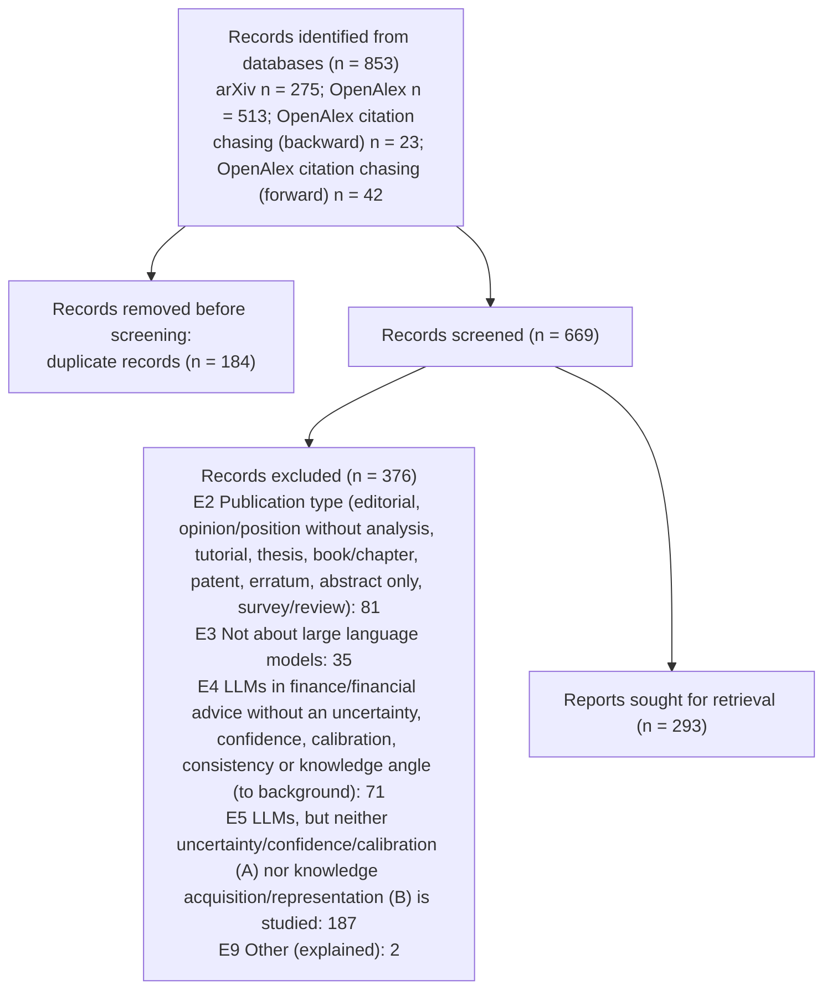

# PRISMA 2020 counts - title/abstract stage



```json
{
 "stage": "ta",
 "tool": "sr-screener 1.0.0",
 "complete": true,
 "pending_records": 0,
 "state_problems": [],
 "identified_by_database": {
  "arXiv": 275,
  "OpenAlex": 513,
  "OpenAlex citation chasing (backward)": 23,
  "OpenAlex citation chasing (forward)": 42
 },
 "identified_total": 853,
 "duplicates_removed": 184,
 "records_screened": 669,
 "records_to_screen": 669,
 "records_excluded": 376,
 "excluded_by_code": {
  "E2": 81,
  "E3": 35,
  "E4": 71,
  "E5": 187,
  "E9": 2
 },
 "reports_sought_for_retrieval": 293,
 "advanced_include": 197,
 "advanced_unclear": 96,
 "advanced_outside_allowed_languages": 223,
 "agreement": {
  "n": 669,
  "both_advance": 271,
  "both_exclude": 378,
  "a_only_advance": 7,
  "b_only_advance": 13,
  "observed_agreement": 0.9701,
  "kappa": 0.939,
  "pabak": 0.94,
  "conflicts": 20,
  "resolved_by": {
   "A+B": 643,
   "QC": 7,
   "ADJ": 19
  }
 },
 "decided_by": {
  "A+B": 643,
  "QC": 7,
  "ADJ": 19
 }
}
```
